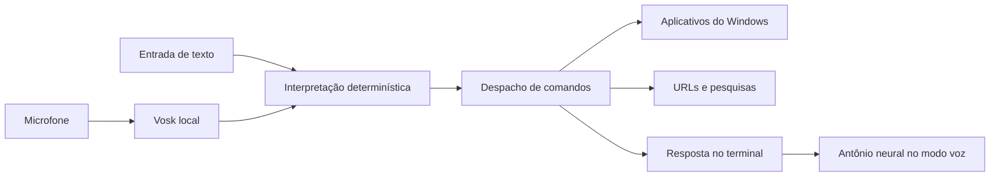

# Icaro — assistente de voz em Python para Windows

**Comandos em português, reconhecimento local e respostas com voz neural.**

Icaro transforma comandos de voz ou texto em ações objetivas no Windows: abrir aplicativos, acessar páginas e pesquisar na web. O projeto combina integração com o sistema operacional, processamento de áudio e testes automatizados em uma aplicação de terminal com um único ponto de entrada.

O reconhecimento de fala usa **Vosk localmente**. As respostas faladas usam **Antônio neural**, voz masculina brasileira do serviço online Microsoft Edge. O modo texto funciona somente com a biblioteca padrão do Python.

## Demonstração do fluxo

```text
PS> python main.py --text
Icaro pronto. Comandos Sugeridos: abrir calculadora | abrir YouTube | abrir github.com | pesquisar previsão do tempo em Campina Grande | sair/encerrar Icaro

Você> abrir calculadora
Aplicativo aberto: calculadora

Você> pesquisar previsão do tempo em Campina Grande
Pesquisa aberta no navegador.

Você> encerrar Icaro
Icaro encerrado.
```

Exemplo ilustrativo do comportamento implementado. No modo voz, a frase reconhecida também aparece no terminal.

## Funcionalidades

- Comandos em português brasileiro por microfone ou texto.
- Abertura de calculadora, bloco de notas, explorador, terminal, navegador e VS Code, quando disponíveis.
- Cadastro de aplicativos por caminho local e de sites por nome.
- Navegação por domínio ou URL HTTP/HTTPS.
- Pesquisa com termos codificados na URL.
- Respostas faladas com voz masculina neural e opção de silenciar.
- Encerramento por comando, Ctrl+C ou fim da entrada no modo texto.

## Arquitetura e decisões de engenharia



| Módulo | Responsabilidade |
| --- | --- |
| `main.py` | Argumentos de CLI, configuração e composição dos modos |
| `commands.py` | Normalização de acentos/maiúsculas e interpretação das frases |
| `assistant.py` | Despacho das ações e mensagens de resposta |
| `apps.py` | Descoberta de executáveis e criação de processos |
| `navigation.py` | Validação de endereços, pesquisa e navegador padrão |
| `config.py` | Leitura e validação da configuração JSON |
| `voice.py` | Captura de áudio, fila e reconhecimento Vosk |
| `speaker.py` | Síntese neural online, decodificação e reprodução |

**Uma lógica de comandos para duas entradas.** Voz e texto chegam ao mesmo interpretador e despachante. Isso permite testar o comportamento sem depender do microfone e mantém as regras consistentes.

**Gramática explícita.** O projeto não usa LLM nem aproximação de nomes. Um comando desconhecido exibe as sugestões. Essa escolha limita a flexibilidade da linguagem, mas torna as ações previsíveis.

**Controle do ciclo de áudio.** A captura usa callback e fila limitada. O stream é fechado por gerenciador de contexto em saída normal ou exceção. Ao responder, o programa pausa a captura, descarta áudio pendente e reinicia o reconhecedor antes de voltar a escutar. Em perda de áudio, interrompe a escuta em vez de despachar uma frase truncada.

**Falhas isoladas.** Erros de aplicativo ou navegador geram uma resposta legível. Falhas de síntese mantêm os comandos funcionando com respostas no terminal. A síntese possui limite de tempo, de texto e de áudio.

**Integração sem shell arbitrário.** Aplicativos são iniciados com uma lista de argumentos e `shell=False`. Texto reconhecido não vira código Python nem comando de terminal.

## Tecnologias

| Tecnologia | Uso |
| --- | --- |
| Python 3.12 x64 | Ambiente validado no Windows |
| Vosk 0.3.45 | Reconhecimento de fala local em português |
| sounddevice 0.5.1 | Streams de entrada e saída de áudio |
| edge-tts 7.3.1 | Cliente comunitário do serviço online de síntese |
| miniaudio 1.71 | Decodificação do MP3 em memória |
| unittest / unittest.mock | Testes e simulação das integrações |
| GitHub Actions | Workflow de testes em Windows e Python 3.12 |

As dependências diretas têm versões fixadas em `requirements.txt`; as transitivas não possuem lock completo. Não há JavaScript na aplicação, interface gráfica, player externo ou FFmpeg.

## Estrutura

```text
icaro/
├── .github/workflows/tests.yml
├── .gitignore
├── README.md
├── VALIDACAO.md
├── config.example.json
├── main.py
├── requirements.txt
├── icaro/
│   ├── __init__.py
│   ├── apps.py
│   ├── assistant.py
│   ├── commands.py
│   ├── config.py
│   ├── navigation.py
│   ├── speaker.py
│   └── voice.py
└── tests/
    ├── test_cli.py
    ├── test_core.py
    ├── test_speaker.py
    └── test_voice.py
```

Abra no VS Code **a pasta que contém `main.py` e este README**. A subpasta `icaro/` contém os módulos internos.

## Instalação e primeiro teste

Sistema alvo: **Windows 11 x64**. Ambiente validado: **CPython 3.12 x64**. Confira as versões instaladas com `py -0p`.

No PowerShell, dentro da raiz do projeto:

```powershell
py -3.12 -m venv .venv
.\.venv\Scripts\python.exe main.py --text
```

Digite os comandos somente quando aparecer `Você>`. O prompt `PS C:\...>` pertence ao PowerShell.

Não é necessário ativar a venv nem alterar a política de execução. O teste inicial por texto dispensa dependências de voz. Com um interpretador adequado já selecionado, também é possível usar `python main.py --text` e `python main.py`.

Para instalar a voz:

```powershell
.\.venv\Scripts\python.exe -m pip install -r requirements.txt
.\.venv\Scripts\python.exe -m pip check
```

## Modelo português e microfone

Baixe [vosk-model-small-pt-0.3.zip](https://alphacephei.com/vosk/models/vosk-model-small-pt-0.3.zip) pelo [catálogo oficial do Vosk](https://alphacephei.com/vosk/models), aproximadamente 31 MB. Extraia a pasta inteira para:

```text
models/vosk-model-small-pt-0.3/
├── final.mdl
├── mfcc.conf
├── ivector/
└── demais arquivos originais do modelo
```

Preserve todos os arquivos. O projeto também aceita modelos com `am/final.mdl`. O modelo é distribuído separadamente e tem sua própria licença, indicada no catálogo.

Liste as entradas disponíveis e escolha o microfone:

```powershell
.\.venv\Scripts\python.exe main.py --list-devices
.\.venv\Scripts\python.exe main.py --device 2
```

Substitua `2` pelo índice de uma entrada da lista. Também pode usar um nome entre aspas. Sem `--device`, o programa usa a entrada padrão:

```powershell
.\.venv\Scripts\python.exe main.py
```

Fale uma frase por vez e faça uma pausa. Espere a resposta terminar antes do próximo comando. Para desativar a síntese online:

```powershell
.\.venv\Scripts\python.exe main.py --mute
```

## Comandos aceitos

| Ação | Exemplos |
| --- | --- |
| Abrir aplicativo | `abrir calculadora`, `abrir bloco de notas`, `abrir VS Code` |
| Abrir site cadastrado | `abrir YouTube`, `acessar GitHub` |
| Abrir endereço | `abrir github.com`, `acessar https://www.python.org` |
| Pesquisar | `pesquisar previsão do tempo em Campina Grande`, `buscar receitas de bolo` |
| Encerrar | `sair`, `encerrar`, `encerrar Icaro`, `tchau` |

Maiúsculas e acentos são normalizados para verbos e nomes; os termos de pesquisa são preservados. `ajuda` e `comandos` exibem as sugestões, embora não apareçam na linha inicial. `sair/encerrar Icaro` na sugestão representa duas alternativas.

Frases como “Ícaro, abre o YouTube para mim” não fazem parte da gramática atual.

## Configuração

```powershell
Copy-Item config.example.json config.local.json
```

Edite o arquivo pessoal. O caminho do editor no exemplo é fictício; substitua-o ou remova a entrada.

| Campo | Regra |
| --- | --- |
| `sites` | Nome e URL HTTP/HTTPS validada |
| `apps` | Nome e caminho absoluto para um arquivo `.exe`, sem argumentos |
| `voice.model_path` | Pasta do modelo; relativa à pasta da configuração ou absoluta |
| `voice.device` | `null`, índice não negativo ou nome do microfone |

Caminhos com espaços são aceitos. Em JSON, use barras normais ou escape as barras invertidas: `C:/Program Files/Meu Editor/editor.exe`.

Seções desconhecidas, tipos inválidos e nomes conflitantes são rejeitados. Um arquivo explícito inexistente produz erro:

```powershell
.\.venv\Scripts\python.exe main.py --text --config config.trabalho.local.json
```

A descoberta automática verifica locais conhecidos do Windows, `wt.exe` e `Code.exe` no PATH e as pastas usuais do VS Code. O terminal usa Windows PowerShell como alternativa. Instalações portáteis ou fora desses locais precisam de configuração. Arquivos `.cmd` não são executados.

## Segurança e privacidade

- Não utiliza `eval`, `exec` ou `shell=True`.
- Navegação aceita apenas HTTP/HTTPS, sem credenciais embutidas, com validação de host e porta.
- Pesquisas usam `urlencode`, preservando caracteres especiais sem concatenar parâmetros livremente.
- Reconhecimento do microfone ocorre localmente; o aplicativo não salva gravações.
- **A síntese neural é online:** os textos das respostas são enviados ao serviço Microsoft, inclusive nomes ou termos presentes nessas mensagens. `--mute` impede esse envio.
- A aplicação não faz login, não envia mensagens e não automatiza compras ou interações dentro dos sites.

Não há palavra de ativação ou identificação de falante. Durante a escuta, uma frase reconhecida como comando pode abrir uma página ou aplicativo sem confirmação.

## Testes e validação

```powershell
.\.venv\Scripts\python.exe -m unittest discover -s tests -v
```

Os **46 testes automatizados** executam sem modelo, microfone, serviço online ou bibliotecas de voz instaladas. As integrações são simuladas.

A suíte cobre interpretação em português, acentos, configuração inválida, URLs, pesquisas com caracteres especiais, caminhos com espaços, executáveis ausentes, erros de abertura, encerramento, pausa/retomada da captura, limites de síntese e liberação dos streams após exceções.

O workflow em `.github/workflows/tests.yml` executa essa suíte em Windows com Python 3.12 a cada push e pull request, sem instalar dependências de áudio.

Resultados observados e limites dos testes manuais estão em [VALIDACAO.md](VALIDACAO.md). Não há medição de cobertura, benchmark de latência ou garantia de precisão da transcrição.

## Limitações e solução de problemas

| Situação | O que verificar |
| --- | --- |
| Modelo não encontrado | Caminho, extração completa e ausência de pasta duplicada |
| Microfone sem acesso | Privacidade e segurança > Microfone no Windows; permissões de aplicativos desktop |
| Dispositivo inválido | `--list-devices`, canais de entrada e seleção com `--device` |
| Perda de áudio | Fechar programas pesados, testar outra entrada e reiniciar |
| Aplicativo ausente | Configurar um `.exe` existente |
| Navegador não abre | Aplicativo padrão para HTTP/HTTPS no Windows |
| Voz neural falha | Internet, firewall e saída padrão; respostas seguem no terminal até reiniciar |
| JSON inválido | Aspas duplas, vírgulas, tipos e barras dos caminhos |
| Acentos incorretos | Executar com `python -X utf8 main.py --text` |

A transcrição varia com ruído, sotaque e nomes estrangeiros. Domínios ditados como “github ponto com” não são reconstruídos: use texto ou nomes cadastrados.

`edge-tts` é um cliente comunitário do serviço Microsoft Edge, não o SDK oficial Azure. O serviço pode mudar ou ficar indisponível. Não foram validados Windows ARM, outros sistemas operacionais ou todos os dispositivos de áudio.